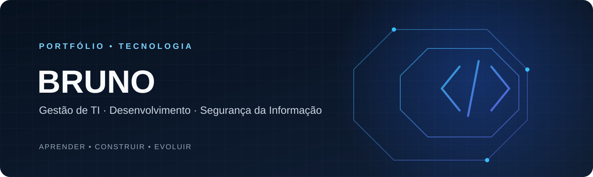

  

<table>
  <tr>
    <td width="23%" align="center" valign="middle">
      
    </td>
    <td valign="middle">
      <h1>Bruno Santos de Lima</h1>
      
<strong>@brunosg24</strong>

      
Estudante de Gestão de TI | Apaixonado por tecnologia, segurança da informação e desenvolvimento.

      
📍 Curitiba, PR, Brasil &nbsp;·&nbsp; <a href="https://www.linkedin.com/in/bruno-santos-de-lima-a48a26181/">LinkedIn</a> &nbsp;·&nbsp; <a href="https://github.com/brunosg24?tab=repositories">Explore meus projetos →</a>

      

        
        
        
        
        
        
      

    </td>
  </tr>
</table>

---

<table>
  <tr>
    <td width="24%" valign="top">
      <h3>Sobre</h3>
      
Busco evoluir na área de tecnologia, com foco em cibersegurança e desenvolvimento, transformando conhecimento em soluções reais.

      
▣ &nbsp; Estudante ▣ &nbsp; Gestão de Tecnologia da Informação ▣ &nbsp; PUC Paraná ⌖ &nbsp; Curitiba, PR

    </td>
    <td width="76%" valign="top">
      <h3>⭐ Destaques dos repositórios</h3>
      <table>
        <tr>
          <td width="20%" valign="top">
            
            <strong><a href="https://github.com/brunosg24/bruno-style-store">Bruno-Style-Store</a></strong> 
            Loja virtual moderna e responsiva. 
            🟡 JavaScript
          </td>
          <td width="20%" valign="top">
            
            <strong><a href="https://github.com/brunosg24/bruno-robo-day-trade">Robô-Day-Trade</a></strong> 
            Estrutura inicial de API em FastAPI. 
            🟡 Python
          </td>
          <td width="20%" valign="top">
            
            <strong><a href="https://github.com/brunosg24/pizzaira-imporio">Pizzaria Império</a></strong> 
            Conceito de cardápio digital. 
            🔴 HTML
          </td>
          <td width="20%" valign="top">
            
            <strong><a href="https://github.com/brunosg24/loja-de-roupa-masculina">Loja Masculina</a></strong> 
            Conceito de e-commerce de moda. 
            🔴 HTML
          </td>
          <td width="20%" valign="top">
            
            <strong><a href="https://github.com/brunosg24/afiliado.store">Affiliate Store</a></strong> 
            Conceito de vitrine de afiliados. 
            🔴 HTML
          </td>
        </tr>
      </table>
    </td>
  </tr>
</table>

## Tecnologias e Ferramentas

  

  
  

